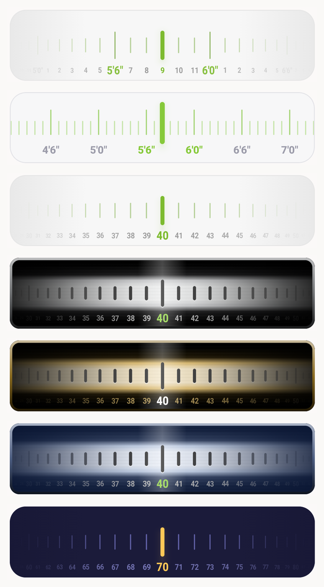
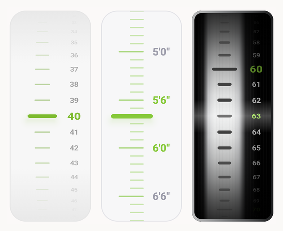

# ScaleWheel

[](https://jitpack.io/#bilaljameel/ScaleWheel)
[](LICENSE)

A scrollable ruler / scale wheel picker for Jetpack Compose, horizontal or vertical.
The selection line always stays in the center; the scale scrolls underneath and snaps to the nearest value.

## Preview

<p align="center">
  
  &nbsp;&nbsp;
  
</p>

## Installation (JitPack)

`settings.gradle.kts`:

```kotlin
dependencyResolutionManagement {
    repositories {
        google()
        mavenCentral()
        maven("https://jitpack.io")
    }
}
```

`build.gradle.kts` (module):

```kotlin
dependencies {
    implementation("com.github.bilaljameel:ScaleWheel:1.1.0")
}
```

## Usage

Only `min`, `max` and `defaultValue` are required.

```kotlin
ScaleWheel(
    min = 0,
    max = 100,
    defaultValue = 40,
    onValueChange = { value -> /* ... */ },
)
```

Height picker in feet/inches (values are inches):

```kotlin
ScaleWheel(
    min = 48,
    max = 84,
    defaultValue = 69,
    majorTickInterval = 6,
    labelFormatter = { "${it / 12}'${it % 12}\"" },
)
```

Custom colors (all optional):

```kotlin
ScaleWheel(
    min = 30, max = 200, defaultValue = 70,
    colors = ScaleWheelDefaults.colors(
        backgroundColor = Color(0xFF1B1B3A),
        borderColor = Color.Transparent,
        majorTickColor = Color(0xFF5B5BA8),
        minorTickColor = Color(0xFF3A3A70),
        textColor = Color(0xFF8888C0),
        selectedTextColor = Color(0xFFFFC857),
        selectionLineColor = Color(0xFFFFC857),
    ),
)
```

Metal (brushed chrome drum with engraved slots):

```kotlin
ScaleWheel(
    min = 0, max = 100, defaultValue = 40,
    style = ScaleWheelStyle.Metal,
    colors = ScaleWheelDefaults.metalColors(),
)
```

The metal tone is changeable: `backgroundColor` is the base metal color and the chrome
shading is derived from it (e.g. a gold drum):

```kotlin
colors = ScaleWheelDefaults.metalColors(
    backgroundColor = Color(0xFFD9B45A),
    borderColor = Color(0xFF8A6B1F),
)
```

Colors for the small numbers are separate: `ScaleWheelDefaults.colors(minorTextColor = ..., selectedMinorTextColor = ...)`
(they default to `textColor` / `selectedTextColor`).

Ruler (clean flat ruler, bottom-aligned ticks, nothing fades):

```kotlin
ScaleWheel(
    min = 36, max = 96, defaultValue = 68,
    style = ScaleWheelStyle.Ruler,
    majorTickInterval = 6,
    labelFormatter = { "${it / 12}'${it % 12}\"" },
    tickSpacing = 10.dp,
)
```

Vertical (every style works in both directions, labels stay upright). Give the wheel a bounded
height; its width is fixed (`ScaleWheelDefaults.Width`):

```kotlin
ScaleWheel(
    min = 0, max = 100, defaultValue = 40,
    orientation = ScaleWheelOrientation.Vertical,
    modifier = Modifier.height(280.dp),
)
```

`shadowColor` sets the dark bands/edges of the metal drum (black by default):

```kotlin
colors = ScaleWheelDefaults.metalColors(
    backgroundColor = Color(0xFFB8C7E0),
    shadowColor = Color(0xFF0A1633),
)
```

Outline (the stroke around the wheel) can be recolored, given a gradient, made thicker or
removed:

```kotlin
// gradient outline
ScaleWheel(
    min = 0, max = 100, defaultValue = 40,
    style = ScaleWheelStyle.Ruler,
    colors = ScaleWheelDefaults.rulerColors(
        borderBrush = Brush.horizontalGradient(listOf(Color(0xFF86C93A), Color(0xFF2AA9E0))),
    ),
    borderWidth = 3.dp,
)

// no outline
ScaleWheel(min = 0, max = 100, defaultValue = 40, showBorder = false)
```

`borderColor` is the plain color, `borderBrush` (any `Brush`) replaces it when set. For `Metal`,
`borderBrush` replaces the automatic bezel shading. `showBorder = false` works for every style, `Metal` included.

## Parameters

| Name | Required | Default | Description |
|---|---|---|---|
| `min` | yes | | Smallest value (inclusive) |
| `max` | yes | | Largest value (inclusive) |
| `defaultValue` | yes | | Initially selected value |
| `modifier` | no | `Modifier` | |
| `onValueChange` | no | `{}` | Called whenever the selected value changes |
| `colors` | no | `ScaleWheelDefaults.colors()` | Background, border, tick, text, selection colors (light/dark aware) |
| `orientation` | no | `Horizontal` | `Horizontal` or `Vertical` |
| `style` | no | `Flat` | `Flat`, `Metal` or `Ruler` (flat light ruler, no shading, all values fully visible) |
| `shape` | no | depends on style | Shape of background/border |
| `showBorder` | no | `true` | Draw the outline; `false` removes it |
| `borderWidth` | no | style default (1dp, Metal 3dp) | Outline thickness; `0.dp` removes it |
| `showSelectionLine` | no | `true` (`false` for Metal) | Colored line in the center |
| `wheelEffect` | no | `true` | Curved cylinder look (ticks fade and compress near the edges) |
| `majorTickInterval` | no | `10` | Tall labeled tick every N values |
| `labelFormatter` | no | `Int.toString()` | Text under major ticks |
| `showMinorLabels` | no | `false` | Small labels under the short ticks too |
| `minorLabelFormatter` | no | `null` (= `labelFormatter`) | Text of the small labels, e.g. only the inches of a feet/inches value |
| `minorTextStyle` | no | 9sp | Style of those small labels |
| `textStyle` | no | 13sp medium | Label text style |
| `tickSpacing` | no | `14.dp` | Distance between two values |
| `hapticFeedback` | no | `true` | Light vibration on each change |

## License

MIT, see [LICENSE](LICENSE).
